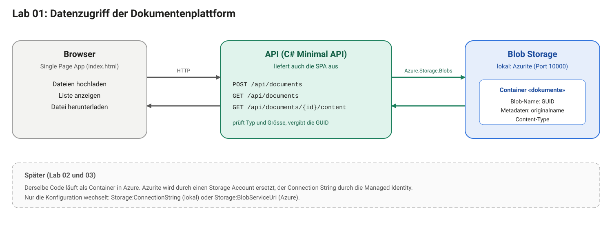

# Lab 01: Speicher wählen und Daten ablegen

## Schwerpunkte

Dieses Lab setzt Ausbaustufe 1 der Dokumentenplattform um: Dateien speichern und abrufen. Zwei Fragen stehen im Mittelpunkt. Welcher Speicher passt zu welchen Daten? Wie greift eine Anwendung auf Objektspeicher zu?

## Lernziele

- für Dateien, Metadaten und gemeinsam genutzte Laufwerke den passenden Speichertyp wählen und die Wahl begründen
- Speicherstufen (Tiers) und Redundanzoptionen nach Zugriffsmuster und Kosten einordnen
- mit einer C#-Minimal-API Dateien in einen Blob-Container schreiben, auflisten und lesen
- Eingaben prüfen: Dateityp, Dateigrösse, fehlende Datei
- die Anwendung lokal gegen Azurite betreiben, ohne Azure-Abo

## Anwendungsfall

Ausgangslage ist die Aufgabe aus Lab 00.

Ist-Zustand: Lieferantenrechnungen und Fotos liegen verteilt in Mail-Anhängen und auf Laufwerken. Es gibt keine zentrale Ablage.

Problem: Dokumente sind nicht auffindbar, und niemand weiss, welche Version die gültige ist.

Ziel: Eine Webseite nimmt Dateien entgegen, legt sie dauerhaft ab und zeigt die Liste aller Dokumente. Jede Datei lässt sich wieder herunterladen.



## Anforderungen

Funktional

- F1: Eine Datei lässt sich über die Webseite hochladen.
- F2: Alle abgelegten Dokumente erscheinen in einer Liste, das neueste zuerst.
- F3: Jedes Dokument lässt sich mit seinem ursprünglichen Dateinamen herunterladen.
- F4: Erlaubt sind PDF, DOCX, JPG und PNG bis 10 MB. Andere Dateien lehnt die API mit einer lesbaren Meldung ab.
- F5: Der ursprüngliche Dateiname bleibt erhalten, auch mit Umlauten und Leerzeichen.

Nicht-funktional

- N1: Dateien liegen im Objektspeicher unter nicht erratbaren Namen (GUID), nicht unter dem Dateinamen der Benutzer.
- N2: Die Anwendung läuft lokal ohne Azure, mit Azurite als Ersatz für Blob Storage.
- N3: Die Art des Zugriffs steht in der Konfiguration. Lokal dient ein Connection String, in Azure später die Managed Identity. Der Code bleibt gleich.

Nicht im Scope: Anmeldung der Benutzer, Virenprüfung, Löschen und Ändern von Dokumenten, automatische Verarbeitung (Modul 2).

## Voraussetzungen

| Voraussetzung | Prüfung |
|---|---|
| Lab 00 abgeschlossen, Entwicklungsumgebung läuft | `bash labs/00-setup/check.sh` meldet «Local environment is ready.» |
| Lab 01 im eigenen Repo vorhanden | Ordner `labs/01-storage` besteht, sonst **Sync fork** (Lab 00, «Spätere Labs übernehmen») |
| Docker-Daemon läuft, oder Node.js ist vorhanden | `docker info` zeigt unter «Server» eine Version. Alternativ zeigt `node --version` eine Version. Docker ist der Standardweg, Node.js genügt für Azurite ohne Docker (Aufgabe 2) |

Ein Azure-Abo ist für dieses Lab nicht nötig. Zum Ansehen der abgelegten Dateien dient der Azure Storage Explorer (Anhang A).

Im Codespace (Variante A und B) läuft der Docker-Daemon im Dev Container und ist sofort verfügbar. Beim lokalen Dev Container (Variante C) muss Docker Desktop vor dem ersten Befehl gestartet sein.

## Projektstand

Der Ordner `labs/01-storage` enthält zwei Stände.

- `start/` ist die Anwendung mit leeren Endpunkten. Konfiguration, Dockerfile, `docker-compose.yml` und die Webseite sind fertig.
- `solution/` ist die fertige Referenz. Sie dient zum Vergleichen nach jeder Aufgabe, nicht als Vorlage zum Kopieren.

Gearbeitet wird in `start/`. Alle Befehle laufen im Terminal des Dev Containers (VS Code: **Terminal → New Terminal**, Eingabeaufforderung `bash`) und in diesem Ordner:

```bash
cd labs/01-storage/start
```

Ein Windows-PowerShell-Fenster auf dem eigenen Rechner (Eingabeaufforderung `PS C:\...>`) ist nicht der Dev Container. Dort fehlen die Werkzeuge der Umgebung, und Docker ist nur verfügbar, wenn Docker Desktop läuft.

In `start/api/Program.cs` markieren Kommentare mit `TODO F1`, `TODO F2` und `TODO F3` die Stellen.

## Aufgabe 1: Speicher wählen

Objekt-, Datei-, relationaler Speicher und Dokumentdatenbank lösen verschiedene Probleme. Die Wahl richtet sich nach dem Zugriffsmuster: Wie gross sind die Daten, wie wird gelesen, wie lange müssen sie aufbewahrt werden?

Vier Speichertypen als Ausgangspunkt:

| Typ | Azure-Dienst | Geeignet für |
|---|---|---|
| Objektspeicher | Blob Storage | grosse, unveränderliche Dateien, Zugriff über HTTP |
| Dateispeicher | Azure Files | Laufwerk mit SMB oder NFS für Anwendungen, die ein Dateisystem erwarten |
| relational | Azure SQL | strukturierte Daten mit Beziehungen und Abfragen über mehrere Felder |
| Dokumentdatenbank | Cosmos DB | flexible JSON-Dokumente, grosse Mengen, Abfrage nach Schlüssel |

**Ablauf**

Für jeden der drei Fälle den Speichertyp wählen und in zwei Sätzen begründen.

1. Fall A: Rechnungs-PDFs und Fotos, zehn Jahre aufzubewahren, nach dem ersten Monat nur noch selten gelesen.
2. Fall B: Metadaten zu jedem Dokument (Lieferant, Betrag, Status), Abfrage nach Lieferant und Status.
3. Fall C: Eine bestehende Desktop-Anwendung erwartet ein Netzlaufwerk mit Ordnern.

Danach zu Fall A Stufe und Redundanz festlegen:

1. Stufe: Hot, Cool, Cold oder Archive. Je kälter die Stufe, desto günstiger der Speicherplatz und desto teurer die Zugriffe. Mindestaufbewahrung: Cool 30 Tage, Cold 90 Tage, Archive 180 Tage. Eine frühere Löschung oder ein früherer Wechsel kostet eine Gebühr.
2. Redundanz: LRS (drei Kopien in einem Rechenzentrum), ZRS (drei Verfügbarkeitszonen einer Region) oder GRS (zusätzlich asynchron in eine zweite Region). Je weiter die Kopien verteilt sind, desto höher der Preis und desto besser der Schutz vor Ausfällen. Redundanz schützt nicht vor versehentlichem Löschen oder Überschreiben, weil alle Kopien dieselbe Änderung erhalten.

**Erwartetes Ergebnis**

- Fall A: Blob Storage. Nach 30 Tagen Cool oder Cold, bei sehr seltenem Zugriff später Archive. Redundanz nach dem Schutzbedarf: LRS genügt für Kopien, die sich neu erzeugen lassen, ZRS oder GRS für Originale. Archive setzt LRS oder GRS voraus und ist mit ZRS nicht kombinierbar.
- Fall B: Dokumentdatenbank oder relationale Datenbank. Blob-Metadaten sind nicht indexiert und lassen sich nicht abfragen. Blob-Index-Tags sind durchsuchbar, aber auf zehn Tags pro Blob begrenzt und für Abfragen nach mehreren Feldern zu knapp. Ausbaustufe 2 nutzt dafür Cosmos DB.
- Fall C: Azure Files, weil nur ein Laufwerk ein Dateisystem bereitstellt.

**Was schiefgehen kann**

- Blob Storage als Datenbank verwenden: Die Suche nach Inhalten eines Dokuments gelingt nicht, nur das Listen nach Namen. Dafür braucht es einen Index oder eine Datenbank.
- Egress-Kosten übersehen: Daten, die eine Azure-Region verlassen, werden pro GB verrechnet. Zwischen Azure-Diensten derselben Region fallen in der Regel keine Transfergebühren an, Ausnahmen nennt die Bandbreiten-Preisseite.
- Archive-Stufe für Daten wählen, die doch gebraucht werden: Archivierte Blobs sind nicht lesbar, bis sie in eine Online-Stufe zurückgeholt sind. Die Rückholung dauert bei Standard-Priorität bis zu 15 Stunden und kostet extra.
- Partition Key in Cosmos DB zu spät wählen: Der Schlüssel lässt sich nicht an Ort und Stelle ändern. Eine Änderung braucht einen neuen Container und eine Datenkopie.

Verfügbarkeit und Preise von Stufen und Redundanz hängen von der Region ab. Vor einer Entscheidung die aktuelle Preisseite von Azure prüfen.

## Aufgabe 2: Azurite starten

Azurite ist ein Emulator für Blob Storage, der lokal auf Port 10000 läuft. Er verwendet ein fest definiertes Entwicklungskonto mit öffentlich bekanntem Schlüssel. Das ist kein Geheimnis und gilt nur für lokale Tests.

Zwei Wege starten Azurite. Der Container braucht einen laufenden Docker-Daemon. Der Start ohne Docker braucht Node.js. Beide belegen Port 10000 und verhalten sich für den Rest des Labs gleich. Nur einer der beiden läuft zur gleichen Zeit.

### Azurite als Container

**Ablauf**

1. Prüfen, ob der Docker-Daemon läuft:

   ```bash
   docker info
   ```

   Die Ausgabe enthält einen Abschnitt «Server» mit einer Versionsnummer. Dann läuft Docker, und es geht weiter mit Schritt 3. Erscheint stattdessen `failed to connect to the docker API` (Windows) oder `Cannot connect to the Docker daemon` (macOS, Linux), läuft der Daemon nicht, und Schritt 2 folgt.

2. Docker starten:

   - Windows, PowerShell auf dem eigenen Rechner:

     ```powershell
     Start-Process "C:\Program Files\Docker\Docker\Docker Desktop.exe"
     ```

     Alternativ Docker Desktop über das Startmenü öffnen.
   - macOS:

     ```bash
     open -a Docker
     ```

   - Linux ohne Docker Desktop:

     ```bash
     sudo systemctl start docker
     ```

   - Codespace und Dev Container (Variante A, B, C): Der Daemon startet mit der Umgebung. Fehlt er, die Umgebung über **F1 → Codespaces: Rebuild Container** (Codespace) oder **F1 → Dev Containers: Rebuild Container** (lokaler Dev Container) neu bauen.

   Danach warten, bis der Daemon antwortet. Der Start von Docker Desktop dauert zwischen einigen Sekunden und einer Minute, bis die Anwendung «Engine running» anzeigt. Unter Windows wartet diese Schleife in PowerShell:

   ```powershell
   while (-not (docker info 2>$null | Select-String "Server Version")) { Start-Sleep 3 }; "Docker läuft"
   ```

   Auf macOS und Linux `docker info` wiederholen, bis der Abschnitt «Server» erscheint.

3. Azurite starten und den Status prüfen. Die Befehle laufen im Ordner `labs/01-storage/start`, im Terminal des Dev Containers oder, bei laufendem Docker Desktop, in einem Terminal auf dem eigenen Rechner:

   ```bash
   docker compose up -d azurite
   docker compose ps
   ```

**Erwartetes Ergebnis**

`docker compose ps` zeigt den Dienst `azurite` mit Status `running` und Port `10000`.

**Was schiefgehen kann**

- `failed to connect to the docker API at npipe:////./pipe/dockerDesktopLinuxEngine ... The system cannot find the file specified` (Windows) oder `Cannot connect to the Docker daemon` (macOS, Linux): Der Docker-Daemon läuft nicht. Der Docker-Client ist installiert, aber nichts nimmt seine Befehle an. Docker wie in Schritt 2 starten und `docker info` wiederholen. Die Meldung erscheint typischerweise in einem PowerShell-Fenster auf dem eigenen Rechner, wenn Docker Desktop nicht gestartet ist. Im Terminal des Dev Containers (siehe Projektstand) läuft der Daemon im Container.
- Docker Desktop bleibt auf «Starting» oder startet nicht: Die WSL-2-Integration prüfen (`wsl --status`), Docker Desktop beenden und neu starten, im Zweifel den Rechner neu starten. Auf Firmenrechnern kann eine Richtlinie die Virtualisierung blockieren. Dann Azurite ohne Docker starten (nächster Abschnitt) oder den Codespace (Variante A oder B) verwenden.
- Port 10000 ist belegt: Ein anderer Azurite oder Prozess läuft bereits. Mit `docker compose down` aufräumen oder den anderen Prozess beenden.

### Azurite ohne Docker

Azurite ist ein Node.js-Paket und läuft ohne Container. Diese Variante eignet sich, wenn Docker nicht läuft oder nicht installiert ist.

**Ablauf**

1. Prüfen, ob Node.js vorhanden ist:

   ```bash
   node --version
   ```

   Die Ausgabe zeigt eine Versionsnummer, zum Beispiel `v24.19.0`. Fehlt Node.js, von `https://nodejs.org` die LTS-Version installieren und ein neues Terminal öffnen.

2. Ein zweites Terminal öffnen und in den Ordner `labs/01-storage/start` wechseln. Azurite starten:

   ```bash
   npx azurite --silent --location .azurite --blobHost 127.0.0.1
   ```

   Das erste Mal lädt `npx` das Paket nach und fragt gegebenenfalls nach Bestätigung (`Ok to proceed?`, mit `y` antworten). Der Befehl bleibt im Vordergrund und gibt keine weitere Ausgabe aus. Das Terminal bleibt für die Dauer des Labs geöffnet.

3. Im ersten Terminal prüfen, ob Azurite antwortet:

   ```bash
   curl -i http://127.0.0.1:10000/devstoreaccount1?comp=list
   ```

   Die Antwort beginnt mit `HTTP/1.1 403`. Der Status 403 ist erwartet, weil die Anfrage nicht signiert ist. Er zeigt, dass Azurite auf Port 10000 antwortet.

   In Windows PowerShell 5.1 ist `curl` ein Alias für `Invoke-WebRequest` und kennt `-i` nicht. Dort `curl.exe` statt `curl` verwenden. In PowerShell 7 und in Bash genügt `curl`.

**Erwartetes Ergebnis**

Azurite läuft im zweiten Terminal, und `curl` erhält die Antwort 403 von Port 10000. Im Ordner `start` liegt ein neuer Ordner `.azurite` mit den Daten. Der Ordner steht in `.gitignore` und kommt nicht ins Repo.

**Was schiefgehen kann**

- `node: command not found`: Node.js fehlt oder das Terminal wurde vor der Installation geöffnet. Node.js installieren und ein neues Terminal öffnen.
- `npx` bricht mit einem Netzwerkfehler ab: Ein Proxy oder eine Firewall blockiert den Download von npmjs.com. Ein anderes Netz oder Azurite als Container verwenden.
- `EADDRINUSE` oder «address already in use» auf Port 10000: Azurite oder der Container läuft bereits. `docker compose down` beenden oder das andere Terminal mit Azurite schliessen.
- `curl` meldet «Connection refused»: Das zweite Terminal wurde geschlossen oder Azurite ist beim Start abgebrochen. Den Befehl aus Schritt 2 erneut ausführen.
- Das Terminal im Dev Container hat kein Node.js: Dann Azurite als Container verwenden, im Codespace läuft Docker.

## Aufgabe 3: Hochladen (F1, F4, F5)

Blob Storage speichert Dateien als Blobs in einem Container. Der Blob-Name ist ein beliebiger String. Metadaten sind Schlüssel-Wert-Paare. Sie werden als HTTP-Header übertragen und müssen deshalb als solche gültig sein. Sicher gültig ist nur ASCII-Text, Sonderzeichen wie Umlaute können scheitern. Der ursprüngliche Dateiname wird deshalb URL-kodiert abgelegt. Namen von Metadaten folgen den Regeln für C#-Bezeichner, die Gesamtgrösse ist auf 8 KB begrenzt.

**Ablauf**

In `start/api/Program.cs` den Endpunkt `POST /api/documents` ausfüllen.

1. Das Formular lesen und die erste Datei nehmen. Fehlt sie oder ist sie leer, 400 mit `{ error }` antworten. Ein zu grosses Formular löst eine Ausnahme aus, die ebenfalls als 400 mit lesbarer Meldung zurückgeht:

   ```csharp
   IFormFile? file;
   try
   {
       if (!request.HasFormContentType)
           return Results.BadRequest(new { error = "Keine Datei übermittelt." });
       file = (await request.ReadFormAsync(ct)).Files.FirstOrDefault();
   }
   catch (Exception e) when (e is InvalidDataException or BadHttpRequestException)
   {
       return Results.BadRequest(new { error = "Datei ist grösser als 10 MB." });
   }

   if (file is null || file.Length == 0)
       return Results.BadRequest(new { error = "Keine Datei übermittelt." });
   if (file.Length > MaxFileSize)
       return Results.BadRequest(new { error = "Datei ist grösser als 10 MB." });
   ```

2. Die Dateiendung gegen `allowedTypes` prüfen. Bei einer anderen Endung 400 mit der Liste der erlaubten Typen:

   ```csharp
   var extension = Path.GetExtension(file.FileName);
   if (!allowedTypes.TryGetValue(extension, out var contentType))
       return Results.BadRequest(new { error = "Erlaubt sind PDF, DOCX, JPG und PNG." });
   ```

3. Eine GUID als Blob-Name erzeugen und die Datei hochladen. Der Content-Type kommt aus `allowedTypes`, nicht vom Client:

   ```csharp
   var id = Guid.NewGuid().ToString();
   var blob = container.GetBlobClient(id);
   await using var stream = file.OpenReadStream();
   await blob.UploadAsync(stream, new BlobUploadOptions
   {
       HttpHeaders = new BlobHttpHeaders { ContentType = contentType },
       Metadata = new Dictionary<string, string>
       {
           [MetaFileName] = Uri.EscapeDataString(Path.GetFileName(file.FileName)),
       },
   }, ct);
   ```

4. Mit 201 und der neuen Id antworten. Dabei die Zeilen `await Task.CompletedTask;` und `return Results.StatusCode(...)` entfernen:

   ```csharp
   return Results.Created($"/api/documents/{id}/content", new { id, fileName = file.FileName, status = "hochgeladen" });
   ```

**Erwartetes Ergebnis**

`dotnet build api` läuft ohne Fehler. Der Upload liefert Status 201 und eine Id.

**Was schiefgehen kann**

- Der Compiler meldet fehlende Typen wie `BlobUploadOptions`: Die `using`-Zeilen am Dateianfang fehlen oder wurden gelöscht.
- Metadaten mit Umlauten lösen eine Ausnahme aus: Der Wert wurde nicht mit `Uri.EscapeDataString` kodiert.
- Der Dateiname im Blob-Namen verursacht Sonderzeichenfehler oder Kollisionen: Deshalb die GUID als Name und der Dateiname nur als Metadatum.

## Aufgabe 4: Auflisten (F2)

Beim Auflisten liefert Blob Storage Metadaten nur auf Anfrage mit. `BlobTraits.Metadata` fordert sie an.

**Ablauf**

Den Endpunkt `GET /api/documents` ausfüllen:

```csharp
var items = new List<DocumentInfo>();
await foreach (var item in container.GetBlobsAsync(BlobTraits.Metadata, cancellationToken: ct))
{
    item.Metadata.TryGetValue(MetaFileName, out var encoded);
    items.Add(new DocumentInfo(
        item.Name,
        encoded is null ? item.Name : Uri.UnescapeDataString(encoded),
        item.Properties.ContentType,
        item.Properties.ContentLength ?? 0,
        item.Properties.CreatedOn,
        "hochgeladen"));
}
return Results.Ok(items.OrderByDescending(i => i.UploadedAt));
```

**Erwartetes Ergebnis**

`GET /api/documents` liefert ein JSON-Array. Es ist leer, solange nichts hochgeladen wurde, danach enthält es die Einträge, das neueste zuerst.

**Was schiefgehen kann**

- Der Dateiname fehlt in der Liste: `BlobTraits.Metadata` wurde nicht übergeben.
- Die Liste ist nicht sortiert: `OrderByDescending` fehlt. Blob Storage garantiert keine Reihenfolge nach Datum.

## Aufgabe 5: Herunterladen (F3, F5)

Ein Blob lässt sich als Stream lesen. Die API gibt den Stream an den Browser weiter, ohne die Datei vollständig in den Speicher zu laden.

**Ablauf**

Den Endpunkt `GET /api/documents/{id}/content` ausfüllen:

```csharp
var blob = container.GetBlobClient(id.ToString());
if (!await blob.ExistsAsync(ct))
    return Results.NotFound();

var props = (await blob.GetPropertiesAsync(cancellationToken: ct)).Value;
props.Metadata.TryGetValue(MetaFileName, out var encoded);
var fileName = encoded is null ? id.ToString() : Uri.UnescapeDataString(encoded);

var stream = await blob.OpenReadAsync(cancellationToken: ct);
return Results.File(stream, props.ContentType, fileName);
```

**Erwartetes Ergebnis**

Der Download liefert die Datei mit dem ursprünglichen Namen und dem richtigen Content-Type. Eine unbekannte Id ergibt 404.

**Was schiefgehen kann**

- Die Route ohne die Einschränkung `:guid` lässt beliebige Zeichenfolgen als Blob-Name zu, darunter Pfadangaben.
- Der heruntergeladene Dateiname zeigt die GUID statt des Originalnamens: Das Metadatum wurde nicht gelesen oder nicht dekodiert.

## Aufgabe 6: Anwendung starten und prüfen

**Ablauf**

Start als Container (braucht Docker, Azurite läuft dabei als Teil von `docker compose`):

```bash
docker compose up --build
```

Start ohne Container, zum Debuggen (Azurite läuft bereits, als Container oder mit `npx`):

```bash
ASPNETCORE_URLS=http://localhost:8080 ASPNETCORE_ENVIRONMENT=Development dotnet run --project api
```

In PowerShell lautet derselbe Aufruf:

```powershell
$env:ASPNETCORE_URLS="http://localhost:8080"; $env:ASPNETCORE_ENVIRONMENT="Development"; dotnet run --project api
```

Die Webseite unter `http://localhost:8080` öffnen (im Codespace über den weitergeleiteten Port 8080). Danach prüfen:

1. Eine PDF-Datei hochladen. Sie erscheint in der Liste.
2. Die Datei über den Link in der Liste herunterladen und mit dem Original vergleichen.
3. Eine PDF-Datei mit Umlaut und Leerzeichen im Namen hochladen, zum Beispiel `Rechnung Müller.pdf`. Name in der Liste und Name beim Download müssen dem Original entsprechen (F5).
4. Eine Textdatei hochladen. Die Webseite zeigt «Erlaubt sind PDF, DOCX, JPG und PNG.»
5. Den Inhalt des Containers im Azure Storage Explorer ansehen (Installation und Bedienung in Anhang A): Container `dokumente`, Blob-Name als GUID, Metadatum `originalname`.
6. Die Fehlerfälle zusätzlich in `test.http` oder mit `curl` abfragen (in Windows PowerShell 5.1 `curl.exe`):

   ```bash
   curl -i -F "file=@sample.pdf" http://localhost:8080/api/documents
   curl -i http://localhost:8080/api/documents
   curl -i http://localhost:8080/api/documents/00000000-0000-0000-0000-000000000000/content
   ```

**Erwartetes Ergebnis**

| Aktion | Antwort |
|---|---|
| Upload PDF | 201, JSON mit `id` |
| Upload `.txt` | 400, «Erlaubt sind PDF, DOCX, JPG und PNG.» |
| Upload über 10 MB | 400, «Datei ist grösser als 10 MB.» |
| Upload ohne Datei | 400, «Keine Datei übermittelt.» |
| Liste | 200, JSON-Array |
| Download mit unbekannter Id | 404 |

**Was schiefgehen kann**

- Die Webseite zeigt «Liste konnte nicht geladen werden (501)»: Ein Endpunkt ist noch nicht ausgefüllt.
- `Connection refused` auf Port 10000: Azurite läuft nicht (Aufgabe 2).
- Der Port 8080 ist belegt: Ein früherer Lauf läuft noch. `docker compose down` beendet ihn.
- Nach `docker compose down` sind die Daten weg: Azurite legt sie im Container ab, und `down` entfernt den Container. Für dieses Lab ist das gewollt. `docker compose stop` und `start` behalten die Daten.

## Aufräumen

Azurite als Container:

```bash
docker compose down
```

Das beendet Azurite und die API. Die hochgeladenen Testdateien gehen mit dem Container verloren.

Azurite ohne Docker: Die API und Azurite mit `Ctrl+C` in ihren Terminals beenden. Der Ordner `.azurite` im Ordner `start` enthält die hochgeladenen Testdateien und lässt sich löschen, sobald die Daten nicht mehr gebraucht werden.

Ein Azure-Abo wurde nicht benutzt, es gibt nichts weiter abzuräumen.

## Definition of Done

- [ ] Für die Fälle A, B und C ist ein Speichertyp gewählt und in zwei Sätzen begründet. Für Fall A sind Stufe und Redundanz festgelegt.
- [ ] Azurite läuft: `docker compose ps` zeigt den Dienst im Status `running` (Container), oder `curl -i http://127.0.0.1:10000/devstoreaccount1?comp=list` antwortet mit 403 (ohne Docker).
- [ ] F1: Der Upload einer PDF-Datei liefert 201 und eine Id.
- [ ] F2: Die Liste zeigt hochgeladene Dokumente, das neueste zuerst.
- [ ] F3: Der Download liefert die Datei identisch zum Original.
- [ ] F4: `.txt` und Dateien über 10 MB werden mit lesbarer Meldung abgelehnt.
- [ ] F5: Ein Dateiname mit Umlaut und Leerzeichen bleibt beim Download erhalten.
- [ ] N1: Im Container `dokumente` (Azure Storage Explorer oder Liste der API) heisst der Blob wie die GUID, nicht wie die Datei. Das Metadatum `originalname` enthält den Dateinamen.
- [ ] N3: Der Code enthält keinen festen Connection String. Der Zugriff kommt aus der Konfiguration.
- [ ] Die eigene Lösung ist mit `solution/` verglichen, Abweichungen sind erklärt.

## Nächste Schritte

Lab 02 («Infrastructure as Code mit Terraform») rollt in Azure aus, was hier lokal läuft: Storage Account, Container Registry und Container-Apps-Umgebung. Der Stand aus `solution/` bildet den Ausgangspunkt von Lab 02.

## Hinweise

- Der Azurite-Schlüssel in `docker-compose.yml` ist öffentlich dokumentiert. Eigene Schlüssel, Connection Strings und Tokens gehören nie ins Repo.
- `DisableAntiforgery()` am Upload-Endpunkt ist eine bewusste Vereinfachung. Ohne Anmeldung gibt es keinen Benutzerkontext, der gegen Cross-Site-Anfragen geschützt werden müsste. Mit Anmeldung wäre der Schutz nötig.
- Die Prüfung der Dateiendung ist kein Sicherheitsmerkmal. Ein Client kann den Inhalt beliebig benennen. Für mehr Sicherheit wären Inhaltsprüfung und Virenscan nötig, siehe «Nicht im Scope».


## Anhang A: Azure Storage Explorer

Der Azure Storage Explorer ist eine eigenständige Anwendung für Windows, macOS und Linux. Er zeigt Container und Blobs eines Storage Accounts, auch des Emulators Azurite, und erlaubt Hochladen, Herunterladen und Löschen. In diesem Lab dient er zum Prüfen dessen, was die API in den Container schreibt. Dieselbe Anwendung arbeitet in Lab 02 und 03 mit dem echten Storage Account.

### A.1 Installation

Download: `https://www.storageexplorer.com`

- Windows: Installationsdatei ausführen. Der Installer richtet die benötigte .NET-10-Laufzeit ein, wenn sie fehlt. Unterstützt sind Windows 10 und Windows 11 in 64 Bit.
- macOS: Fassung für Intel oder Apple Silicon wählen. Unterstützt ist macOS 10.15 und neuer. Die benötigte .NET-10-Laufzeit muss zur Architektur passen.
- Linux: Installation über das Snap-Paket `storage-explorer`. Die Anwendung benötigt einen Passwort-Manager des Systems. Bei Snap verbindet `snap connect storage-explorer:password-manager-service :password-manager-service` ihn.

Die Installation erfolgt auf dem eigenen Rechner, nicht im Dev Container. Die Anwendung ist nur für die Ansicht nötig. Alle Aufgaben des Labs funktionieren ohne sie, `curl` und die Liste der API zeigen dieselben Daten.

### A.2 Mit Azurite verbinden

Voraussetzung: Azurite läuft (Aufgabe 2). Der Storage Explorer startet den Emulator nicht selbst.

Azurite läuft im Dev Container, der Storage Explorer auf dem eigenen Rechner. Das gilt für alle drei Varianten der Entwicklungsumgebung (Codespace im Browser, Codespace in VS Code, lokaler Dev Container). Der Port 10000 muss deshalb auf den eigenen Rechner weitergeleitet sein.

1. In VS Code die Ansicht **Ports** öffnen. Port 10000 («Azurite Blob») ist bereits eingetragen, weil `.devcontainer/devcontainer.json` ihn weiterleitet. Fehlt er, **Add Port** wählen und `10000` eintragen. Im Browser-Codespace (Variante A) erreicht der Port den eigenen Rechner nicht von selbst. Dort leitet die GitHub CLI auf dem eigenen Rechner ihn weiter: `gh codespace ports forward 10000:10000`. Das Fenster bleibt geöffnet, solange die Verbindung gebraucht wird. Ohne GitHub CLI genügt die Ansicht über `curl` (Aufgabe 6).
2. Azure Storage Explorer öffnen.
3. Im Ressourcenbaum **Local & Attached → Storage Accounts → Emulator - Default Ports** öffnen. Der Eintrag verbindet automatisch, wenn Azurite lokal erreichbar ist, auf den Standardports lauscht (Blob: 10000) und HTTP verwendet.
4. Den Eintrag aufklappen: **Blob Containers → dokumente**.

Fehlt der Eintrag oder bleibt er leer, manuell verbinden:

1. Das Stecker-Symbol in der linken Leiste öffnen (**Connect**).
2. **Local storage emulator** wählen und **Next**.
3. Anzeigename vergeben, den Blob-Port `10000` eintragen, **Next**, **Connect**.

Liegt der weitergeleitete Port auf einer anderen lokalen Nummer, funktioniert der Eintrag mit den Standardports nicht. Dann **Connect → Storage account or service → Connection string** wählen und den Wert aus `docker-compose.yml` (Variable `Storage__ConnectionString`) einsetzen. Dabei `azurite:10000` im `BlobEndpoint` durch `127.0.0.1:<lokale Portnummer>` ersetzen.

Die Connection String von Azurite enthält den öffentlich dokumentierten Entwicklungsschlüssel. Für den echten Storage Account in Lab 02 und 03 dient die Anmeldung mit dem Azure-Konto, nicht ein Schlüssel.

### A.3 Nutzung

- Container öffnen: **Blob Containers → dokumente** zeigt alle Blobs. Die Namen sind GUIDs, weil die API den Dateinamen nicht als Blob-Namen verwendet (N1).
- Ansicht aktualisieren: **Refresh** in der Werkzeugleiste. Neue Uploads erscheinen erst danach.
- Blob herunterladen: markieren, **Download**.
- Blob-Eigenschaften ansehen: markieren, Rechtsklick, **Properties**. Dort stehen Content-Type, Grösse und die Metadaten, darunter `originalname` mit dem URL-kodierten Dateinamen.
- Blob löschen: markieren, **Delete**. Die API liefert danach für diese Id 404. Die Löschfunktion der Anwendung selbst gehört nicht zum Scope.
- Hochladen testen: **Upload → Upload Files** legt eine Datei ohne Metadaten ab. Sie erscheint in der Liste der API mit der GUID als Dateiname, weil `originalname` fehlt. Das zeigt, warum die API beim Upload das Metadatum selbst setzt.
- Container leeren zwischen zwei Durchläufen: alle Blobs markieren, **Delete**. Alternativ `docker compose down` und neu starten, Azurite legt die Daten im Container ab.

### A.4 Was schiefgehen kann

- Der Eintrag **Emulator - Default Ports** zeigt eine Fehlermeldung: Azurite läuft nicht. `docker compose ps` (Container) oder das Terminal mit `npx azurite` (ohne Docker) prüfen (Aufgabe 2).
- Der Container `dokumente` fehlt: Die API legt ihn beim ersten Start an. Die API starten (Aufgabe 6) und im Storage Explorer **Refresh** wählen.
- Die Verbindung bleibt leer: Port 10000 ist nicht auf den eigenen Rechner weitergeleitet oder liegt auf einer anderen lokalen Portnummer. Die Ansicht **Ports** prüfen und, wenn nötig, den manuellen Weg mit Connection String gehen.
- Unter Linux fragt die Anwendung nach einem Passwort-Manager oder startet nicht: Die Snap-Schnittstelle `password-manager-service` ist nicht verbunden (A.1).
- Meldungen zu Zertifikaten (`self signed certificate`): Die Verbindung geht über HTTPS. Azurite läuft in diesem Lab mit HTTP. Beim manuellen Verbinden darf das Häkchen für HTTPS nicht gesetzt sein.
